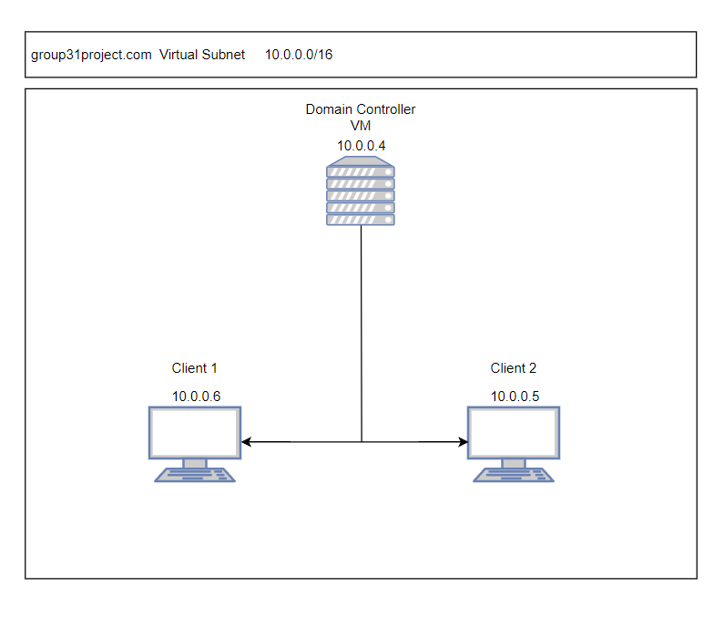
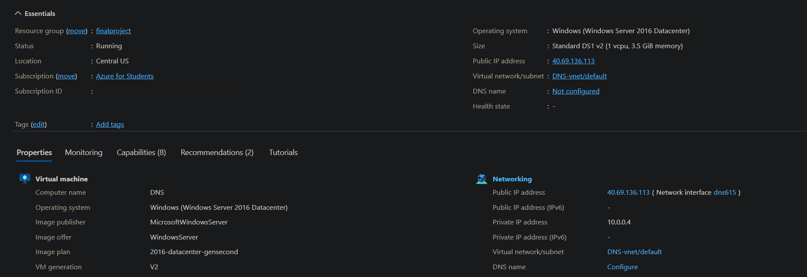
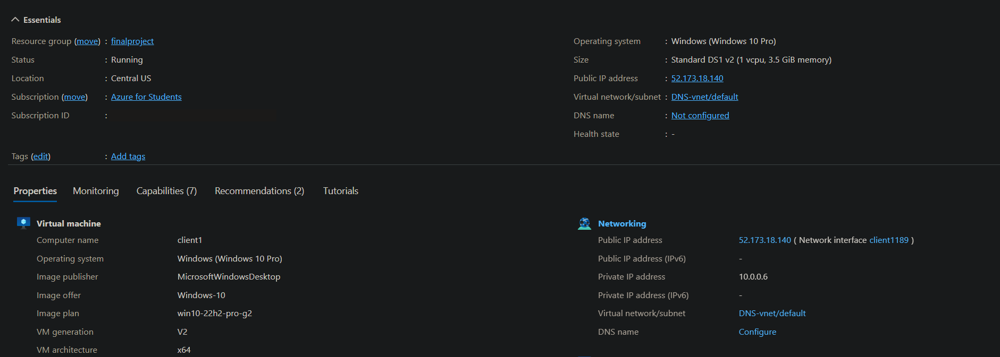
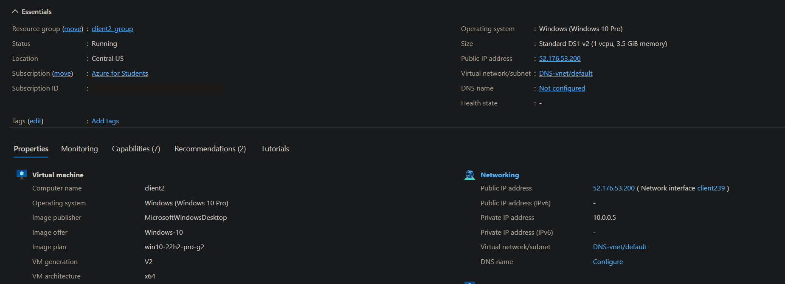
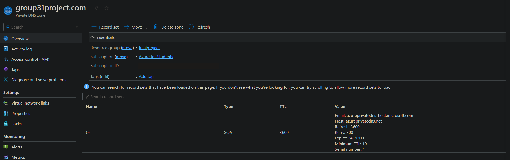
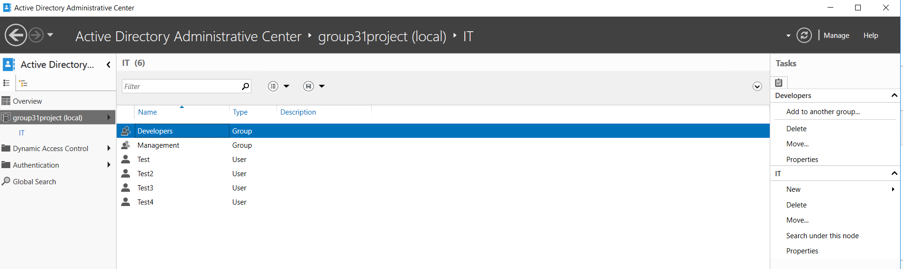
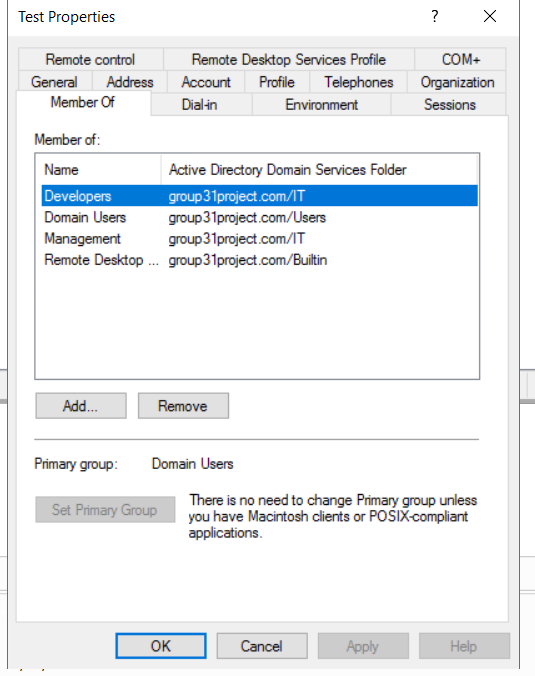
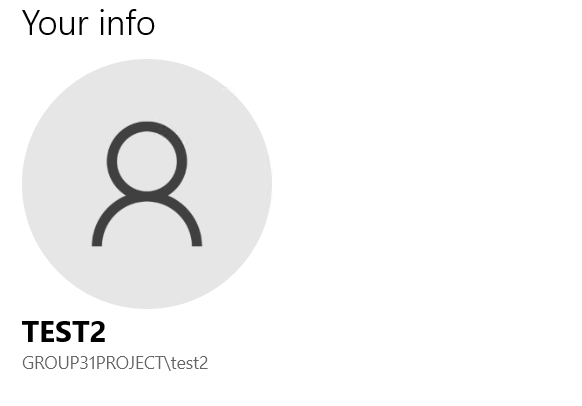

# Deploying Active Directory on Microsoft Azure

A cloud identity project building a working Active Directory environment entirely in Microsoft Azure. The environment has a Windows Server 2016 domain controller, two domain-joined Windows 10 clients, an Azure Private DNS Zone for name resolution, and a structured directory of users, groups, and an organizational unit, all on a private Azure virtual network. The domain, `group31project.com`, is named after the environment, Group31, a fake company used for this lab.

The goal was to show how an organization could move centralized identity management to the cloud: authenticate users once, control access through groups rather than individual accounts, and do it without maintaining on-premises servers.

---

## Table of Contents

- [Highlights](#highlights)
- [Why Active Directory in the Cloud](#why-active-directory-in-the-cloud)
- [Architecture](#architecture)
- [Building the Environment](#building-the-environment)
  - [Virtual Network and VMs](#virtual-network-and-vms)
  - [DNS with an Azure Private DNS Zone](#dns-with-an-azure-private-dns-zone)
  - [Domain, OU, Users, and Groups](#domain-ou-users-and-groups)
  - [Joining Clients and Logging In](#joining-clients-and-logging-in)
- [Challenges and Troubleshooting](#challenges-and-troubleshooting)
- [Comparing Identity Options](#comparing-identity-options)
- [What I Learned](#what-i-learned)
- [What I Would Do Differently Today](#what-i-would-do-differently-today)
- [References](#references)

---

## Highlights

The environment runs three Azure VMs on a private `10.0.0.0/16` virtual network: a Windows Server 2016 domain controller at `10.0.0.4` and two Windows 10 Pro clients at `10.0.0.5` and `10.0.0.6`. Name resolution is handled by an Azure Private DNS Zone for `group31project.com`, linked to the virtual network. The directory has an IT organizational unit containing four test users and two security groups, Developers and Management, with group-based membership instead of per-user permissions. Both clients were joined to the domain, and every test account successfully logged in with its domain credentials. Spot pricing kept the cost of the whole build low on an Azure for Students subscription.

---

## Why Active Directory in the Cloud

Active Directory is the backbone of identity management in most Windows environments. It provides single sign-on, so users log in once and reach the resources they are allowed to use. It lets administrators organize users into groups and organizational units and grant permissions to whole teams instead of individual accounts. It enforces security settings and configuration across machines through Group Policy. And it ties into DNS for name resolution and into Kerberos, LDAP, and SSL/TLS for secure authentication and directory access.

Running it in Azure keeps all of that while removing the hardware. There are no on-premises servers to buy, power, repair, or upgrade, and users can reach the environment from anywhere with an internet connection, which suits distributed teams and remote workers. Azure also integrates directly with Microsoft services such as Microsoft 365 and Azure App Service.

---

## Architecture

| VM | Role | OS | Size | Private IP |
|----|------|----|------|------------|
| DC1 | Domain controller | Windows Server 2016 Datacenter | Standard DS1 v2 (1 vCPU, 3.5 GiB) | 10.0.0.4 |
| Client1 | Domain-joined workstation | Windows 10 Pro (22H2) | Standard DS1 v2 (1 vCPU, 3.5 GiB) | 10.0.0.6 |
| Client2 | Domain-joined workstation | Windows 10 Pro (22H2) | Standard DS1 v2 (1 vCPU, 3.5 GiB) | 10.0.0.5 |

All three VMs sit on the same virtual network and subnet in the Central US region. The Private DNS Zone for `group31project.com` is linked to that network so every machine resolves the domain internally.

---

## Building the Environment

### Virtual Network and VMs

The build started with an Azure virtual network using the default `10.0.0.0/16` address space. On it, I deployed the Windows Server 2016 VM that would become the domain controller and two Windows 10 Pro client VMs. Each VM needed an additional network adapter to attach it to the project's virtual network.

To keep costs down, the VMs ran on Azure Spot pricing. Spot VMs are heavily discounted but can be evicted when Azure needs the capacity back, and that happened once during the project. It was an acceptable trade-off for a lab, but I would not use Spot VMs for anything going into production.

| DC1 | Client1 | Client2 |
|:---:|:---:|:---:|
|  |  |  |

### DNS with an Azure Private DNS Zone

The original plan was for the Windows Server VM to act as both the domain controller and the DNS server. Changing DNS settings on the server inside Azure risked breaking its connectivity to the rest of the environment, so I moved DNS to Azure instead. Creating a Private DNS Zone for `group31project.com` and linking it to the virtual network gave the environment private, internal name resolution with very little effort.

### Domain, OU, Users, and Groups

On the domain controller, I created the `group31project.com` domain and an **IT** organizational unit. Inside the OU are four test users and two security groups, **Developers** and **Management**. The first test user belongs to both groups, while the other three belong only to Developers, which shows how group membership controls access for whole roles at once instead of one account at a time.

| Active Directory Administrative Center | Group Membership for a Test User |
|:---:|:---:|
|  |  |

### Joining Clients and Logging In

Both Windows 10 clients were joined to the domain, and each test account was able to sign in to the machines with its domain credentials, confirming that authentication through the domain controller worked end to end.

| Signed In as a Domain User | Client Joined to the Domain |
|:---:|:---:|
|  |  |

---

## Challenges and Troubleshooting

**DNS on the domain controller.** Running DNS on the same Windows Server VM as the domain controller was the original design, but adjusting the server's DNS settings inside Azure threatened to cut off its connectivity. Moving name resolution to an Azure Private DNS Zone solved the problem and simplified the design.

**Remote login permissions.** The first attempts to sign in with the test accounts failed because domain users do not have permission to log in over Remote Desktop by default. Adding each account to the built-in **Remote Desktop Users** group fixed it.

**Spot VM eviction.** Azure evicted the Spot VMs once during a period of high demand. Nothing was lost, but it was a practical reminder of the trade-off between cost and availability.

---

## Comparing Identity Options

Organizations have several ways to run directory services, and the right one depends on their needs.

| Option | How It Runs | Strengths | Trade-offs |
|--------|-------------|-----------|------------|
| On-premises Active Directory | Domain controllers on the organization's own servers | Full control over the local network environment | Hardware, maintenance, upgrades, and backups are all the organization's responsibility |
| AD DS on Azure VMs (this project) | Domain controllers as VMs in Azure | Classic AD features without owning hardware; reachable from anywhere | The organization still manages the Windows Server VMs |
| Microsoft Entra ID (formerly Azure AD) | Fully managed cloud identity service | No servers to run; built for cloud apps; Microsoft handles maintenance | Works differently from classic AD; advanced features require paid tiers |

Microsoft Entra ID comes in tiers. The free tier covers basic cloud identity, while the paid **P1** and **P2** tiers add security features such as Conditional Access and identity protection, making them a better fit for larger organizations with stricter requirements. Azure itself also offers several purchasing models, including free credits, pay-as-you-go, and enterprise agreements, with more features and higher cost at each level.

---

## What I Learned

The project gave me a practical understanding of how identity sits at the center of an enterprise environment: once the domain, OU, and groups were in place, access for every user came down to which groups they belonged to. It also showed me that moving infrastructure to the cloud is not just lifting and shifting servers. Some things, like DNS, are better handled by the platform's own managed services. Leading the team taught me as much as the technology did, from planning the build and keeping it moving to troubleshooting problems and documenting the result clearly.

---

## What I Would Do Differently Today

Looking back at this project with more experience, there are a few things I would change in a production design.

| Area | Change |
|------|--------|
| Availability | Deploy at least two domain controllers across availability zones, and use regular-priced VMs instead of Spot instances |
| Hybrid identity | Sync the directory with Microsoft Entra ID through Entra Connect for single sign-on to cloud apps |
| Access | Remove public IPs from the VMs and reach them through Azure Bastion or a VPN instead of direct RDP |
| Security | Enforce MFA and Conditional Access, and apply least-privilege Group Policy baselines |
| Monitoring | Send sign-in and security logs to Microsoft Sentinel or Azure Monitor for detection and auditing |

---

## References

- Patton, Bryan, and Matthew Vinton. "Active Directory vs. Azure Active Directory: What You Need to Know." *The Quest Blog*, 19 Feb. 2024. [blog.quest.com](https://blog.quest.com/active-directory-vs-azure-active-directory-what-you-need-to-know/)
- "What Is Azure Active Directory and Why You Need It." *Cloud Business*, 8 Mar. 2022. [cloudbusiness.com](https://cloudbusiness.com/what-is-azure-active-directory/)
- "What Is Azure Active Directory and Why You Need It [Updated]." *Simplilearn*, 6 June 2023. [simplilearn.com](https://www.simplilearn.com/tutorials/azure-tutorial/azure-active-directory)

---

## Author

**Geoffrey Mackey**, Cybersecurity Professional & Student at the University of Cincinnati.
